# 03 Web UI

A read-only website over the backup: what changed and who changed it, every version of an object, the comparison of any two versions, assignments in plain words, deleted objects and a search through names and settings. It reads a clone of the repository `intune-config-backup-data` (branch `main`, and `backup-<name>` for more tenants) and never writes to Intune or to the backup; only the settings and approvals are saved, as variables of the variable group `intune-config-backup`. Setup: [Setup](02-setup.md), step 10.

| Page | Shows |
|---|---|
| Changes | the start page. Under the title one sentence: when the last backup ran and how many objects. Four cards: the objects, the changes of the last 7 days against the week before, the restores waiting for a second person (with `Backup.Restore`) or who changed most, and the last backup run. Then the changed objects per day as a chart (last 3 months, 30 or 7 days; the axes say what they count, the pointer shows the numbers of a day). Below every change as a table, newest first, grouped by day, one row per object with type, kind of change, person and time; a click on a column title sorts by it; the arrow at the end opens what changed and the reason of a restore (when no setting changed, the fields of the file that did, e.g. a version number Intune counts up itself); a save of more than three objects (a first backup) is one row until opened. Tabs *All Changes*, *Deleted*, *Restores*, filtered by period, person and type. Tick rows and *Actions* offers *Undo These Changes…* (with `Backup.Restore`, the versions before them), *Export as CSV* and *Copy Links*; Esc clears the selection. A restore from the page is the change of the person who asked for it, with who approved it (the Intune audit log names only the restore app, which wrote it) |
| Objects | one table of all objects: name, type, platform, assigned to, who changed it last, last change; a click on a column title sorts by it, again the other way round; tabs *All*, *Assigned*, *Not Assigned*, *Deleted*, filtered by name or setting and by type. Tick rows (the box in the header ticks all, or clears what is ticked) and *Actions* offers *Restore an Earlier Version…* (with `Backup.Restore`, up to 50 objects, [below](#restore-several-objects)), *Export as CSV* and *Copy Links* for any number |
| Notifications | in the sidebar, with the number of what needs someone: a failed last backup, restores that wait for your approval, the Apple push certificate, ADE and VPP tokens within 60 days (the backup also sends a Teams card from 30 days, in the 04:00 run). Each can be dismissed; it comes back after a day while it lasts, or at once when it changes (a token a step closer to its date, another restore waiting) |
| Account | at the bottom of the sidebar, with the name and the highest role: appearance (light, dark, auto), roles and session, links to the backup in Azure Repos, sign out |
| Groups | a table of every group (and all devices, all users) something is assigned to, with the number of objects; one group shows a table of what it gets now: name, type, how (*Included* or *Excluded*, with the filter) and the last change. A click on a column title sorts by it. Assignments on an object page link here |
| Documentation | the tenant documentation of the last backup (folder `Documentation` in the data repository): the pages on the left (overview and one per type with its count). The overview shows the number of objects and types, the type with the most objects and a table of the groups and targets things are assigned to; a type page lists every object on one line (platform, number of settings, who gets it); a click opens its settings, assignments and scripts in one table, sections as light rows; *Expand All* opens all, a filter opens what matches, printing prints all; filter; *Export*: this page or all types as CSV (one line per setting: type, object, section, setting, value; semicolons and UTF-8 for Excel), this page as Markdown; *Print* (also to PDF) |
| Tenant | with more tenants ([More Tenants](08-tenants.md)): the menu under the name at the top of the sidebar switches; another tenant is read only (no restore, approvals or replicas) |
| Restores | role `Backup.Restore`: every restore that writes, as a table with the tabs *Waiting* (for a second person, [below](#approvals)), *Running* and *Done* (the last 7 days, restored, failed, rejected or withdrawn; a failed one says why, in Intune's words, and needs nothing more: it stays as a record and goes after 7 days); the number on the item is how many wait. Above it, *Started Here*: checks started on this computer that have not asked for approval yet (after *Ask for Approval* the request itself is in the table), with a link back (the browser keeps them for a day) |
| Replicas | role `Backup.Admin`: other tenants as a copy of this one, at the bottom of the sidebar ([Replicas](09-replicas.md)): *Plan*, the steps of the run, then four counts (to create, to update, already the same, not copied) and the objects of each |
| Search | in the middle of the bar above every page (Ctrl K, on a Mac ⌘K): names, settings, group names, scripts; below the results *In the history*: the versions in which the text came or went, with who and when, also for a Settings Catalog setting searched by its name |
| Object | the path, the name with its type and platform, *More* (*Show JSON*, *Copy Object ID*, *Copy Link*) and, with `Backup.Restore`, *Restore This Version…*. The version as *Changes* (compared with the version before or any older one), *Settings* (the whole version in plain words, with assignments) or *JSON*; on the right the history with person and time, and the details with the object ID. *Restore This Version…* opens the restore above the version; *Restore…* there shows first what would change, then *Ask for Approval*, always with a reason ([Restore](04-restore.md)). A deleted app has no *Restore*: its file is not in the backup, so it is added in Intune again first |

The look is [shadcn/ui](https://ui.shadcn.com) with the [tweakcn](https://tweakcn.com) theme *Modern Minimal* (Tailwind CSS, Base UI for menus and lists, one corner radius everywhere, light and dark): a sidebar with the tenant and *Back Up Now* at the top, the pages, then *Notifications*, *Settings*, *Replicas* and the account at the bottom; the search in the middle of the bar above the page; short messages at the bottom right (saved, copied, server not reachable, sign-in expired). After a new deployment an open page says so and offers *Reload*.

| | |
|---|---|
| 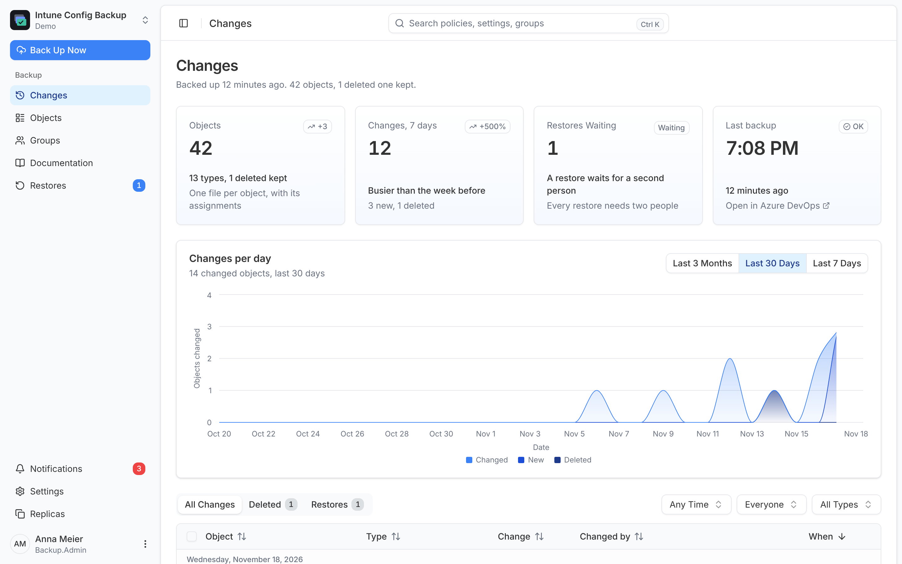 | 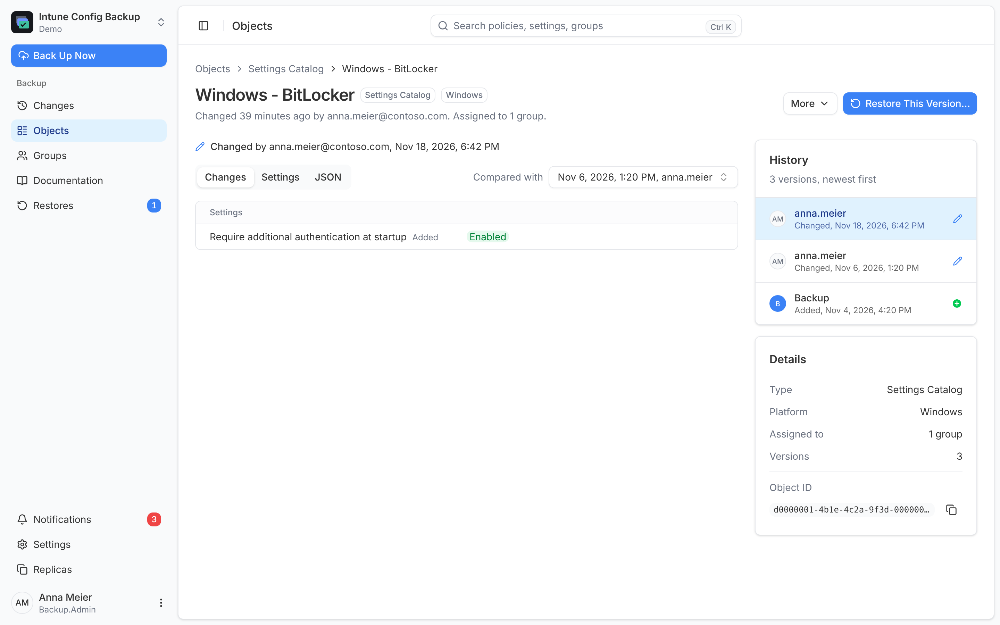 |
| 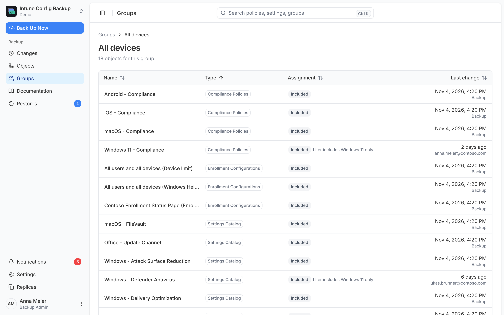 | 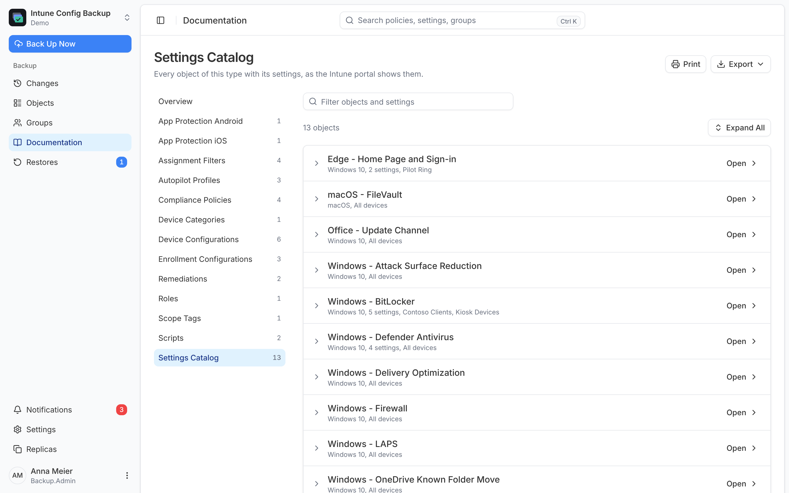 |
| 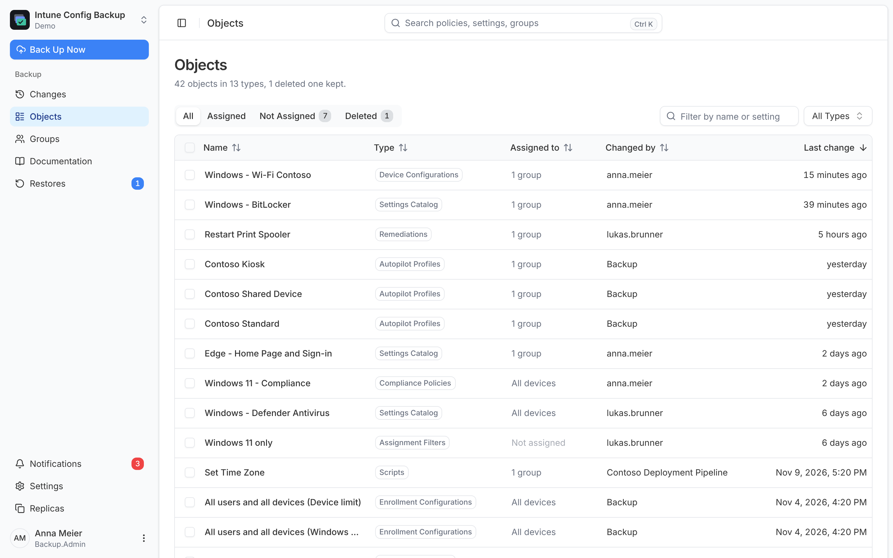 | 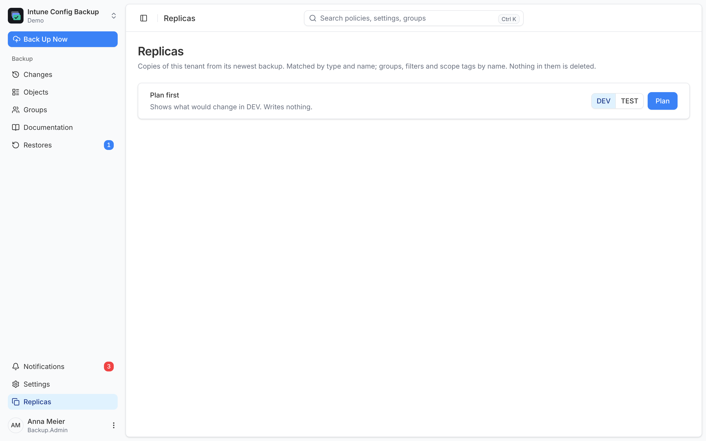 |
| 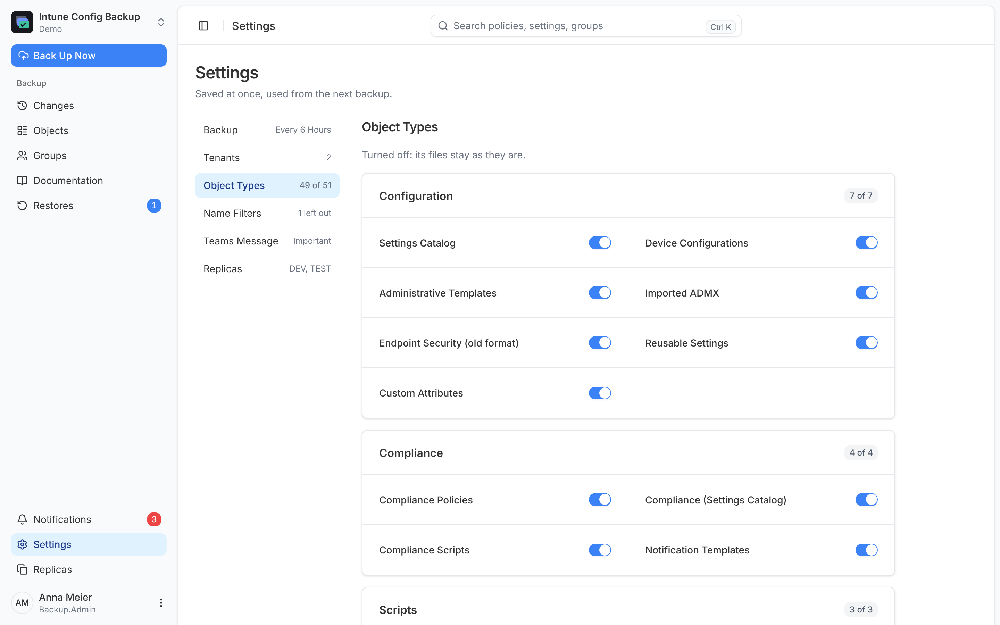 | 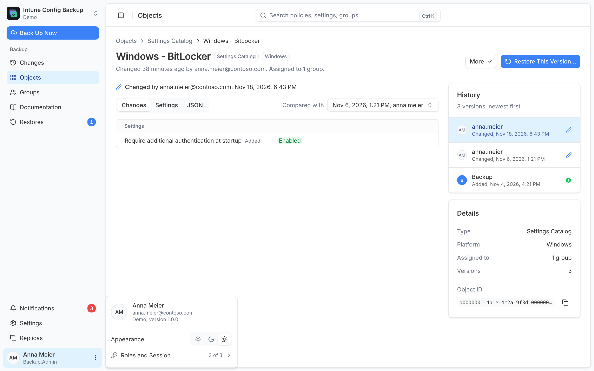 |

**Demo:** <https://marc-baumgartner.github.io/intune-config-backup/> runs the same pages in the browser with a made-up tenant and a made-up person signed in (`npm run build:demo` builds it into `dist/demo`; a normal build contains neither the demo code nor its data).

**Back Up Now**, at the top of the sidebar, starts the pipeline `icb-backup` at once, without waiting for the next scheduled run. Everyone with `Backup.Read` may use it: the backup only reads Intune. The button follows the run live with a bar and the time left, measured on the last runs; then a message says how many new versions it saved, and the page loads again. A click while a backup runs starts no second one; the run gets the person as its parameter `requestedBy`.

## Settings

With the role `Backup.Admin` the sidebar has **Settings**. The sections are listed on the left (Backup, Tenants, Object Types, Name Filters, Teams Message, Restore, Replicas), each with its current value; a click shows one. Each setting is a row in a card: name and hint on the left, the switch, list or field on the right. The object types in *Object Types* and *Restore* are one card per area as in the Intune admin center (Configuration, Compliance, Scripts, Updates, Apps, Enrollment, Apple, Tenant Administration, Entra ID), with how many are on. Every change is saved at once into the variable `ICB_SETTINGS` (JSON) of the variable group `intune-config-backup` and used from the next backup run; nothing in Intune changes.

| Setting | Does |
|---|---|
| Schedule | every 6 hours (default), twice a day, daily in the morning (04:00 UTC, 05:00 in Zurich in winter) or in the evening (22:00 UTC, 23:00 in Zurich in winter, midnight in summer), weekly (Monday) or off (*Back Up Now* only); Azure DevOps runs schedules in UTC, so the local time moves by an hour with summer time; the footnote shows the times in your time zone and the runs a month. The health check allows the gap of the schedule |
| Tenants | the name of this tenant in the menu, and more tenants with their reader app ([More Tenants](08-tenants.md)) |
| Encrypted OMA-URI values in plain text | the same as `--include-oma-values` ([Backup Format](06-backup-format.md)); needs a write permission for the backup identity |
| Teams message | after a run with changes: *Off*, *Important* (an object deleted, or newly assigned to all devices or all users) or *All*. Each line names the person and links to the version in the web UI. When it is on, also: a restore or a replica that waits for an approval (with a button to open it in Azure DevOps), its result, and a failed backup, restore or replica run |
| Links open | address of the web UI for those links; filled in with the page's own address |
| Leave out objects | *Name Filters*: a name in the field and *Add*, the cross next to a name removes it; saved at once. `*` for anything, case does not matter (`Test - *`). Such objects are not written; their files from before stay as they are. *Back Up Only* works the same way the other way round |
| Back up only | names, like IntuneCD's prefix (`Contoso - *`): when set, every other object is left out the same way |
| Object types | a type turned off is not read any more; its files stay as they are, nothing looks deleted. *Off Until Turned On*: Autopilot devices (can be thousands) and Activation Lock bypass codes |

### Teams message

The message goes to a Teams channel through a workflow: in Teams, channel → *⋯ → Workflows* → *Post to a channel when a webhook request is received*, copy its URL, and put it into the variable **`NOTIFY_WEBHOOK_URL`** of the variable group `intune-config-backup-secrets`, with the lock on. Then run `icb-deploy-web` once, so the web UI gets it too (for a request for approval). The URL lets anyone post to that channel, so it is a secret, not a setting on the page. A failed message is a warning in the run, never a failed backup.

## Restore several objects

*Objects*, tick up to 50, *Actions → Restore an Earlier Version…*; or on *Changes* tick the changes and *Actions → Undo These Changes…* (a deletion whose object exists again under a new ID, restored already or made by hand, is left out; the row links to the new one). Each gets a version: by default the one before its last change (or before the ticked change), or before its deletion; another can be chosen per object. One check shows what each would change, one reason, one *Ask for Approval*. Objects that already match are left out; nothing is deleted. Deleted apps are left out before the check, with a note: their file is not in the backup.

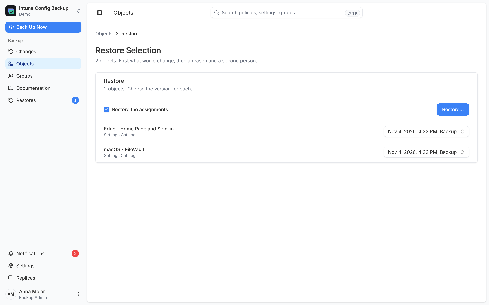

## Approvals

Like *Multi Admin Approval* in Intune: every restore that writes needs a second person, so the yes after *Restore…* is **Ask for Approval**. The page has run the check first and keeps the request in the variable `ICB_APPROVALS` of the variable group.

1. Someone with `Backup.Restore` asks (one open request per object: approved both, the second would overwrite the first); the page moves to the request under *Restores*, where it stays: *Waiting*, then *Running*, then *Done*. With Teams messages on, the channel gets a card with a link to the request.
2. Anyone else with `Backup.Restore` opens it under *Restores*: the version, who asked, the warnings (e.g. Conditional Access that could lock people out) and the check as a diff. *Approve and Restore* or *Reject*, always with a reason (the server refuses a decision without one).
3. Approving starts the restore at once; the page follows it. Rejecting writes nothing: the one who asked sees *Rejected by …* with the reason on the object page, and Teams gets a card if messages are on. The run `icb-restore` gets both and the request's ID as parameters (`requestedBy`, `approvedBy`, `approvalId`); it checks the approval again in `ICB_APPROVALS` before it writes, and the next backup writes both names into the history.

The one who asked cannot approve their own request (except for a test with the variable `ICB_SELF_APPROVAL` set to `true` in the variable group, [Setup](02-setup.md), step 5; not on the Settings page on purpose); the server checks this, not only the page. No restore that writes can start without an approval, also not through the API or by starting the pipeline by hand. Decided requests stay listed for 7 days. Needs sign-in (Entra): on your own computer without sign-in there is no second person.


| | |
|---|---|
| 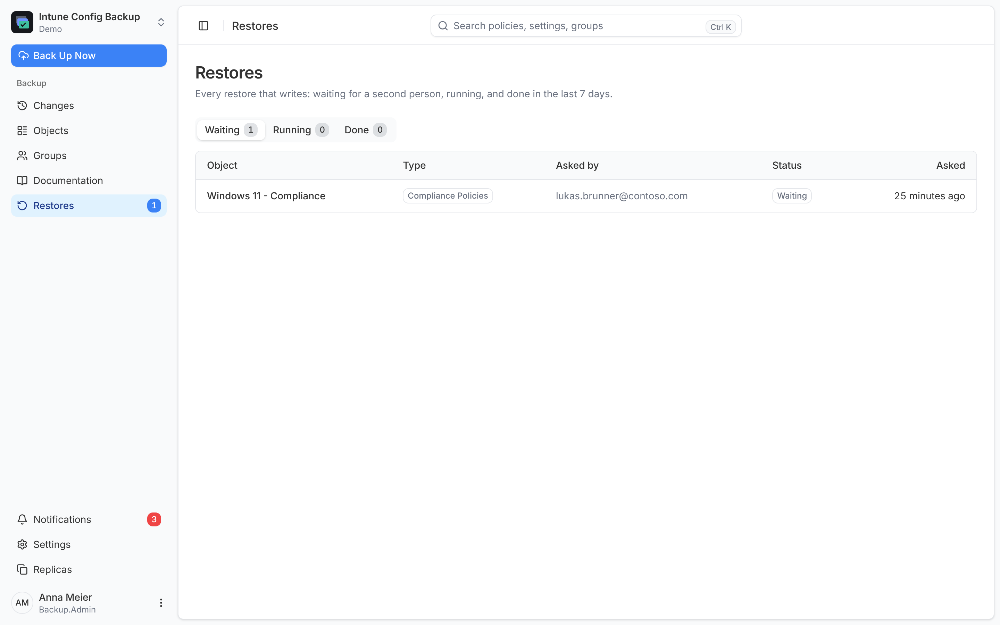 | 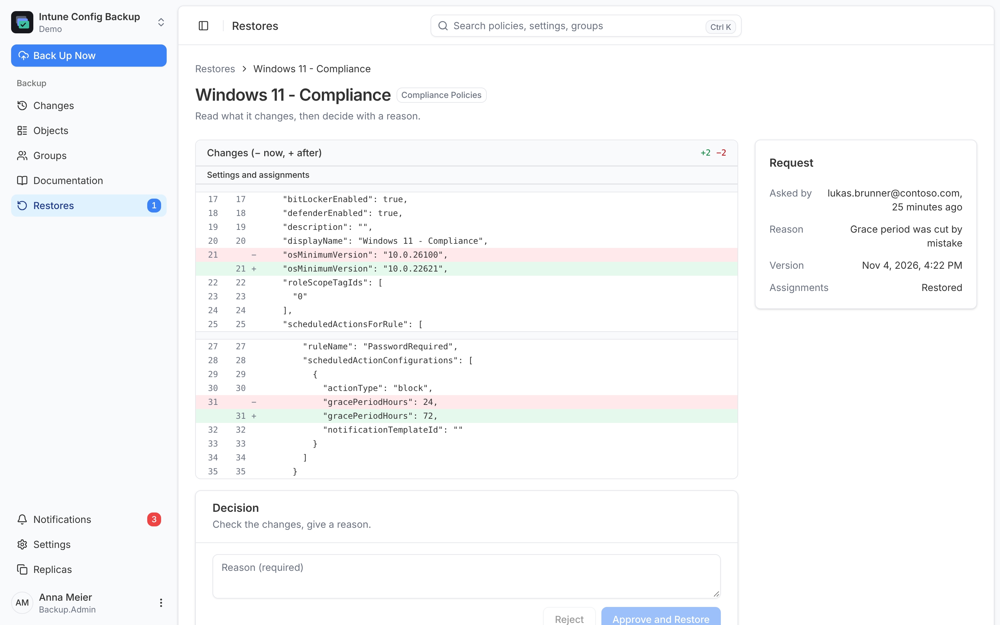 |

## Who may do what

| Group | Role | May |
|---|---|---|
| `G_ICB_Readers` | `Backup.Read` | read everything, *Back Up Now* |
| `G_ICB_Restore` | `Backup.Restore` (includes reading) | restore, approve the restore of someone else |
| `G_ICB_Admins` | `Backup.Admin` (includes reading) | the Settings page, more tenants, *Replicas* |

The roles are app roles of `IntuneConfigBackup.Web`, given to the groups in *Enterprise applications → IntuneConfigBackup.Web → Users and groups* ([Setup](02-setup.md), steps 1 and 2). Nobody gets in without one:

| Who signs in | What happens |
|---|---|
| an account of another organization | Entra refuses it (the app is single tenant); the page says *Wrong Organization* and offers another account. The server would refuse such a token too |
| someone of your tenant without an assigned group | Entra refuses the sign-in (*Assignment required*); the page says *No Access* and names the account |
| someone with a role | the backup, with what that role allows |

The account menu (top right, *Roles and Session*) shows which roles a person has. After a change in a group: sign out and in again.

## On your own computer

For development or a look without Azure: clone both repositories and start the server. Without sign-in it answers only on this computer (`127.0.0.1`).

```powershell
git clone https://dev.azure.com/<organization>/<project>/_git/intune-config-backup-data backup
git clone https://dev.azure.com/<organization>/<project>/_git/intune-config-backup tool
cd tool
npm ci
npm run build
node dist/serve.js --repo ..\backup
```

Open <http://127.0.0.1:4300/>. The server pulls the clone every 5 minutes (`--pull-minutes`, 0 turns it off). With `--tenant-id` and `--client-id` (or `WEB_TENANT_ID`, `WEB_CLIENT_ID`) it asks for the Entra sign-in; add `http://localhost:4300/` as a redirect URI of `IntuneConfigBackup.Web` for that. Restore, *Back Up Now* and Settings need `ADO_ORG_URL` and `ADO_PROJECT` and a sign-in to Azure DevOps (`az login`) that may start the pipelines.

In Azure the container does the same: `Dockerfile` builds it, `deploy/azure/entrypoint.sh` clones `REPO_URL` (branch `REPO_BRANCH`, default `main`) with the managed identity at start; port 8080.

## Security

- Read only: the server runs `git log`, `git show`, `git grep`, `git pull` and `git clone` (of a tenant's branch), nothing else; object IDs and versions are checked before they reach Git.
- The backup can hold OMA-URI values in plain text (`--include-oma-values`): whoever has `Backup.Read` sees them. Assign the role like access to a password safe in that case.
- Tokens stay in the browser tab (session storage); the page allows connections only to its own server and to Entra ID (Content Security Policy).
